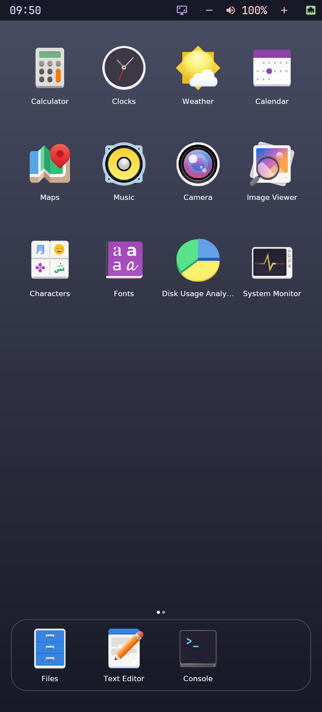
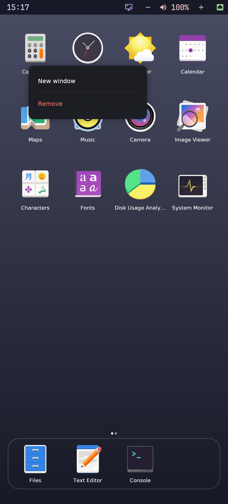
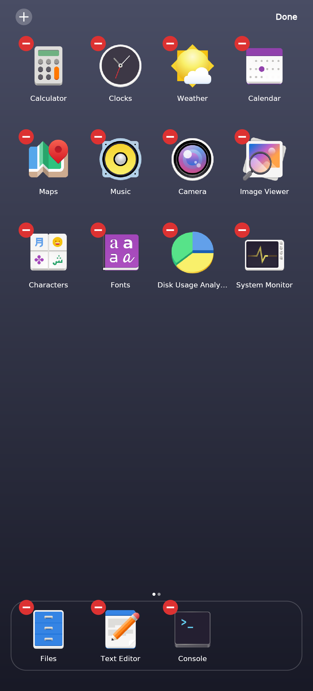
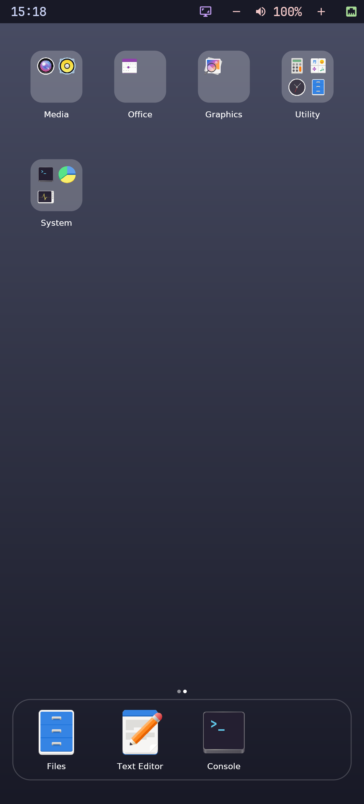
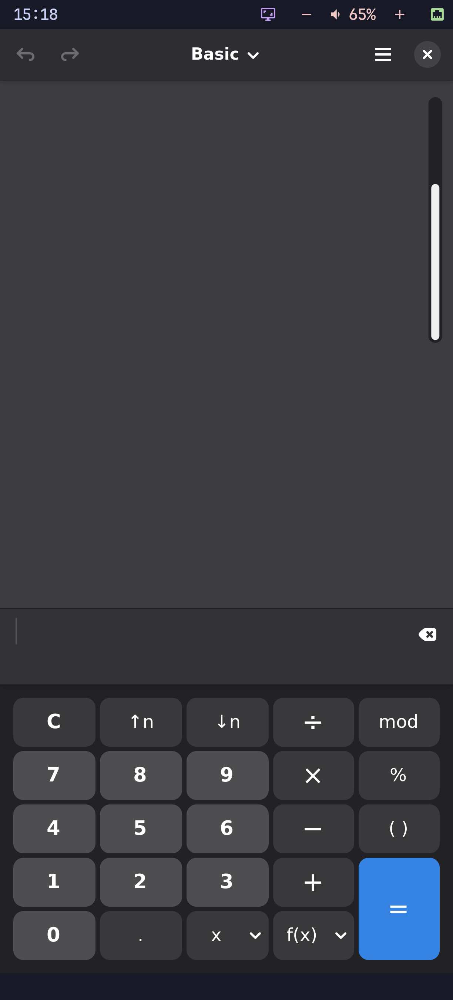
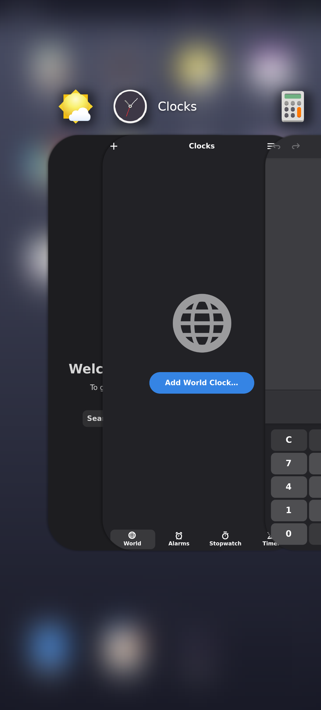

# Springchick

## A Wayland compositor for Linux phones, written in Rust with Smithay and Skia


## What it does

- **One-finger UI.** Swipe up to go home, sideways to switch. Springs are
  interruptible mid-flight.
- **Live cards.** Windows keep rendering through every transition — no frozen
  screenshots.
- **Home grid.** Pages, drag-to-reorder, hide apps, dock. Long press for menu.
  Pull down to search.
- **Rotation.** Automatic rotation for fullscreen media and games.
- **Hardware bindings.** Full support for long/short/chorded hardware button mappings.
- **Keyboard.** wvkbd pops up automatically, at the right scale.
- **Wide protocol support.** Screencopy, screenshots, clipboard, idle inhibitor,
  session lock, external display mirroring.
- **Power efficient** uses systemd user slices for background
  tasks, uclamp to ensure smooth animations, and avoids unnecessary redraws. Also
  supports VRR (Depending on GPU support)

> [!IMPORTANT]
>
> This project is made with LLM assist, so if you have philosophical
> objections to that, please don't use it. I do not consider this to be a "slop"
> project as I've sunk a lot of time and effort into it, but I accept everyone has
> their own opinions on the matter.

## Screenshots








Regenerated by `just screenshots` (the `vm-screenshots` VM check).

## Install

Nightly packages are built from `main` and published to our registries on
code.bas.es. I daily drive them, but no stability guarantees until an actual
release.
Versions look like `0.1.0.20260913`. Initial stable release planned soon.

### NixOS

The best supported path. Add the repo as a flake input and enable
`programs.springchick`.

### postmarketOS

Needs a **systemd** postmarketOS install (`pmbootstrap init` → systemd).

```sh
sudo curl -JO --output-dir /etc/apk/keys \
  https://code.bas.es/api/packages/marcus/alpine/key
echo 'https://code.bas.es/api/packages/marcus/alpine/edge/nightly' \
  | sudo tee -a /etc/apk/repositories
sudo apk update && sudo apk add postmarketos-ui-springchick
```

`postmarketos-ui-springchick` pulls in `springchick` plus the session bits
(wvkbd + its systemd user unit, the portal stack, gnome-keyring, tinydm). If
you would rather wire that up yourself, `apk add springchick` alone is just the
compositor and its `springchick-session` wrapper.

### Mobian / Debian

_Untested by me, would love some feedback on these._

```sh
sudo curl -fsSL https://code.bas.es/api/packages/marcus/debian/repository.key \
  -o /etc/apt/keyrings/forgejo-marcus.asc
echo 'deb [signed-by=/etc/apt/keyrings/forgejo-marcus.asc] https://code.bas.es/api/packages/marcus/debian trixie nightly' \
  | sudo tee /etc/apt/sources.list.d/springchick.list
sudo apt update && sudo apt install springchick
```

### Arch

_Untested by me, would love some feedback on these._

```sh
curl -fsSL https://code.bas.es/api/packages/marcus/arch/repository.key \
  | sudo pacman-key --add -
sudo pacman-key --lsign-key marcus@noreply.code.bas.es
```

The `lsign-key` step is required, or `pacman -Sy` rejects the repo database as
"unknown trust". Then append to `/etc/pacman.conf`:

```ini
[springchick-nightly]
Server = https://code.bas.es/api/packages/marcus/arch/springchick-nightly/$arch
```

```sh
sudo pacman -Sy springchick
```

### Starting it

All packages ship a Wayland session
(`/usr/share/wayland-sessions/springchick.desktop`), so greetd or GDM will list
**springchick**. `/usr/share/springchick/config.example.toml` documents every
option at its default — copy it to `/etc/springchick/config.toml` or
`~/.config/springchick/config.toml`.

Building the packages yourself: [packaging/README.md](packaging/README.md).

## Roadmap

- Closer integration with waydroid
- Folder support and free homescreen layout
- Richer search
- Initial 0.1 release

## Source Code

_The Authorative home for this repo is <https://code.bas.es/marcus/springchick/> -
Github is a mirror to allow easier contributions and visibility._
